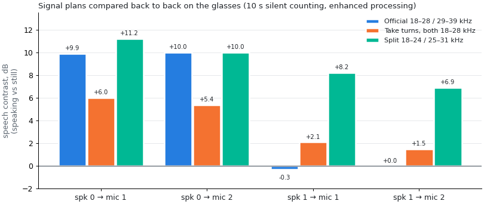
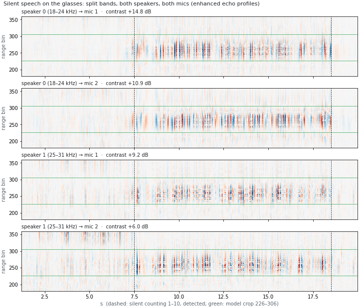
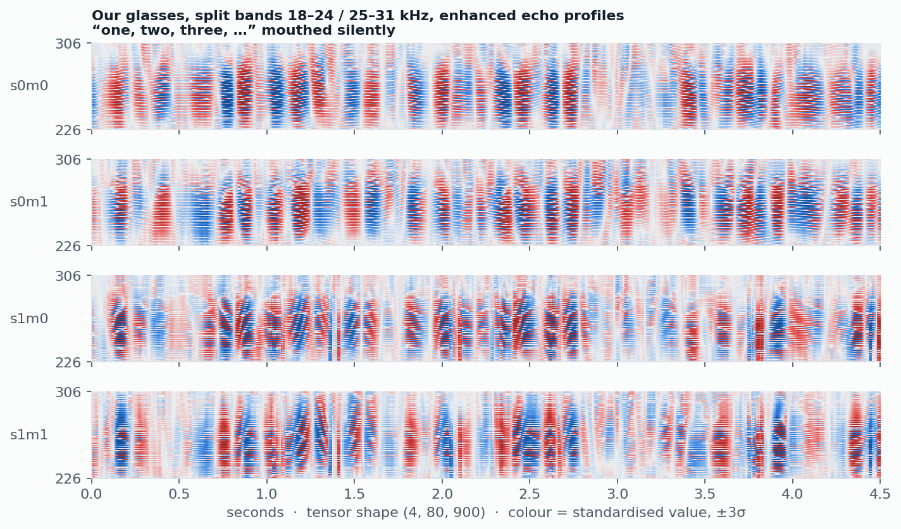
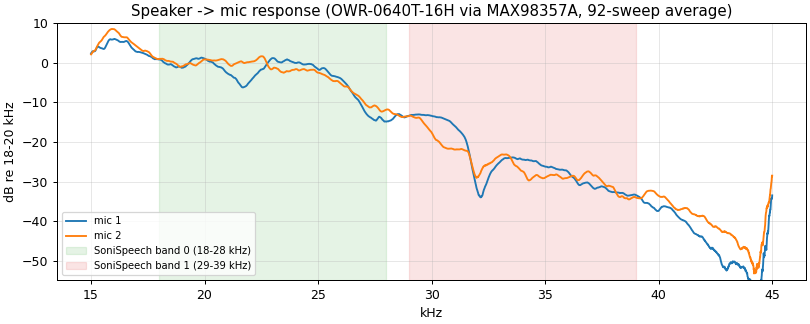

# sonar-hardware

Hardware for the sonar glasses: a Teensy 4.0 sends ultrasonic FMCW chirps through two
MAX98357A amps and two micro speakers, clocks two PDM MEMS microphones, and streams the raw
echoes to a Mac over USB.

The decoding software (a SoniSpeech reproduction) is in
[akapegu/sonar-glasses](https://github.com/akapegu/sonar-glasses).

**Status (2026-11-26):** the rig is mounted on a glasses frame in the SoniSpeech layout
(speakers under one lens, mics under the other). With split bands (speaker 0 at 18–24 kHz,
speaker 1 at 25–31 kHz) silent speech shows on all four echo paths (see
[Recorded signals](#recorded-signals)). The trained SoniSpeech model does not transfer to a new
wearer and device, so the demo follows EchoSpeech: a 31-command recogniser trained on the
wearer's own data ([experiments/echospeech](experiments/echospeech)). Every measurement is in
[docs/rig-handoff.md](docs/rig-handoff.md).

## Contents

| Path | What it is |
|---|---|
| [docs/wiring.html](docs/wiring.html) | Complete wiring diagram (current bench: separate mic/amp clocks, every resistor, pin map) |
| [docs/rig-handoff.md](docs/rig-handoff.md) | Parts, datasheet links, verified limits, wiring, signal plan, safety rules, bring-up order, open decisions |
| [blink_test/](blink_test/) | Upload sanity check: blinks the onboard LED (pin 13 only) |
| [mic_capture/](mic_capture/) | Experiment 1 firmware: clocks both PDM mics (1.6 MHz start-up, then 3.2 MHz) and streams raw bits over USB. Produces no audio. |
| [tools/mic_capture.py](tools/mic_capture.py) | Mac side: records, checks clock/data health per mic, saves `captures/*.npz` + `.wav`, plots spectra |
| [speaker_sweep/](speaker_sweep/) | 15–45 kHz sweep on amp A (safety-capped), mics recording; amps on their own clock (SAI2, pins 4/3/2) |
| [tone_direct/](tone_direct/) | Diagnostic: drives a speaker straight from pins 14/15 through 1.5 kΩ, bypassing the amp |
| [sonispeech_mode/](sonispeech_mode/) | The dataset's chirps on both amps (18–28 kHz on A, 29–39 kHz on B), level and channel commands from the Mac |
| [tools/sweep_measure.py](tools/sweep_measure.py) | Speaker→mic frequency response by synchronous averaging of the sweep |
| [tools/sonispeech_capture.py](tools/sonispeech_capture.py) | SoniSpeech-mode recording: dataset-format WAV, official-style echo profiles, optional enhanced movement picture |
| [tools/make_tx_header.py](tools/make_tx_header.py) | Copies the official chirps from a local dataset into a git-ignored firmware header |
| [tools/make_figures.py](tools/make_figures.py) | Regenerates the figures below from local recordings |
| [tools/run_model.py](tools/run_model.py) | Runs the trained SoniSpeech model (software repo) on a rig recording |
| [experiments/](experiments/) | take_turns, split_bands (current signal plan), echospeech (command demo: collection, dataset) |

## Recorded signals

**Signal plans compared on the glasses.** Speech contrast (how much the echo pattern changes while
silently counting versus sitting still), back to back in the same position, for the four echo paths
(2 speakers × 2 mics). With the official SoniSpeech bands, speaker 1's 29–39 kHz band carries no
speech on our speakers; splitting 18–31 kHz into 18–24 kHz (speaker 0) and 25–31 kHz (speaker 1)
makes all four paths carry speech. Details: [experiments/split_bands](experiments/split_bands),
[experiments/take_turns](experiments/take_turns).



**Silent speech on the glasses, current setup.** Split bands, both speakers, both mics, silently
counting 1–10 with no prompts during the recording. Enhanced echo profiles (4-frame coherent
average, 50 ms difference). Speech shows on all four paths, +6 to +15 dB above the still period.



Zoomed in: 4.5 s from the middle of the counting, the model's crop only (bins 226–306), drawn
exactly like the software repo's model-input figure (same colour map; each path standardised over
the speaking frames, ±3σ). Every mouthed number shows as its own burst on all four paths.



**Why the band split.** The speaker→mic response through the amp, measured with a 15–45 kHz sweep
averaged over 92 repeats: flat to about 26 kHz, then falling steeply. Driving the speaker straight
from two Teensy pins showed the speaker itself causes most of the loss.



## Toolchain (macOS)

- [arduino-cli](https://arduino.github.io/arduino-cli/) (`brew install arduino-cli`)
- Teensy core `teensy:avr` 1.62.0 (board index: `https://www.pjrc.com/teensy/package_teensy_index.json`)

```sh
arduino-cli config add board_manager.additional_urls https://www.pjrc.com/teensy/package_teensy_index.json
arduino-cli core update-index && arduino-cli core install teensy:avr

arduino-cli board list                      # Teensy shows as usb:<id>, FQBN teensy:avr:teensy40
arduino-cli compile --fqbn teensy:avr:teensy40 blink_test
arduino-cli upload  --fqbn teensy:avr:teensy40 -p usb:<id> blink_test
```

### Mic test (Experiment 1)

```sh
python3 -m venv --system-site-packages .venv && .venv/bin/pip install pyserial   # once
arduino-cli upload --fqbn teensy:avr:teensy40 -p usb:<id> mic_capture
.venv/bin/python tools/mic_capture.py -s 10      # jingle keys near the mics while it records
```

Needs numpy, scipy and matplotlib. Each mic should show a ones density of about 0.50, and
200,000 words/s. If one mic shows flat noise at every frequency, reseat its breadboard wires:
that was a loose contact here.

### Troubleshooting

- **The Mac doesn't see the Teensy at all:** try another micro-USB cable before blaming the
  board. Many cables are charge-only or flaky for data, and a bad one looks exactly like a dead
  board (macOS logs `failed to create device` / `persistent enumeration failures`). Test the
  cable with a phone first.
- **An upload hangs with the LED off:** the board is waiting in its bootloader and Teensy Loader
  has stalled. Quit Arduino IDE and Teensy Loader, then run the upload again.

## Safety

The speakers are rated 5 mW. Firmware must cap the amplitude at ≤ 14% of full scale, soft-start
the amplitude, and keep each chirp windowed and zero-mean. Full rules are in
[docs/rig-handoff.md](docs/rig-handoff.md#firmware-safety-rules-non-negotiable).
