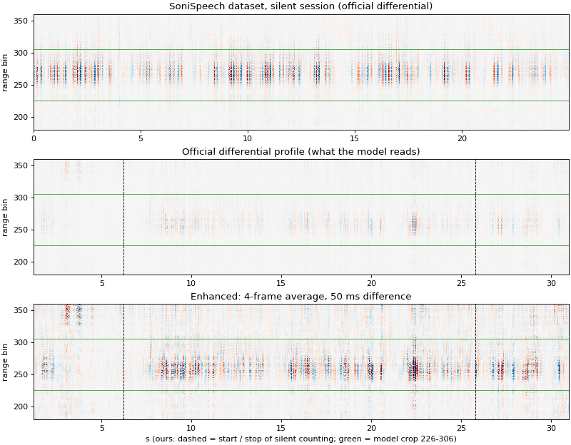
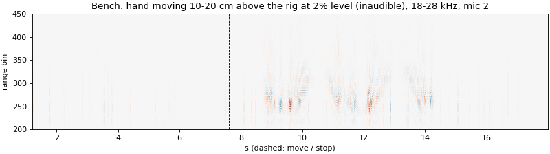

# sonar-hardware

Hardware for the sonar glasses: a Teensy 4.0 sends ultrasonic FMCW chirps through two
MAX98357A amps and two micro speakers, clocks two PDM MEMS microphones, and streams the raw
echoes to a Mac over USB.

The decoding software (a SoniSpeech reproduction) is in
[akapegu/sonar-glasses](https://github.com/akapegu/sonar-glasses).

**Status (2026-11-26):** the rig is mounted on a glasses frame in the SoniSpeech layout
(speakers under one lens, mics under the other) and plays the dataset's own 18–28 kHz chirp.
Silent speech shows up in the echo profiles, fainter than in the dataset (see
[Recorded signals](#recorded-signals)). The 29–39 kHz band is about 23–24 dB weaker than
18–28 kHz with our speakers (OWR-0640T-16H); the paper used OWR-05049T-38D. Details and every
measurement are in [docs/rig-handoff.md](docs/rig-handoff.md).

## Contents

| Path | What it is |
|---|---|
| [docs/wiring.html](docs/wiring.html) | Complete wiring diagram (current bench: separate mic/amp clocks, every resistor, pin map) |
| [docs/rig-handoff.md](docs/rig-handoff.md) | Parts, datasheet links, verified limits, wiring, signal plan, safety rules, bring-up order, open decisions |
| [blink_test/](blink_test/) | Upload sanity check: blinks the onboard LED (pin 13 only) |
| [mic_capture/](mic_capture/) | Experiment 1 firmware: clocks both PDM mics (1.6 MHz start-up, then 3.2 MHz) and streams raw bits over USB. Produces no audio. |
| [tools/mic_capture.py](tools/mic_capture.py) | Mac side: records, checks clock/data health per mic, saves `captures/*.npz` + `.wav`, plots spectra |
| [speaker_sweep/](speaker_sweep/) | 15–45 kHz sweep on amp A (safety-capped), mics recording; amps on their own clock (SAI2, pins 4/3/2) |
| [tone_direct/](tone_direct/) | Diagnostic: drives a speaker straight from pins 14/15 through 1.5 kΩ, bypassing the amp |
| [sonispeech_mode/](sonispeech_mode/) | The dataset's chirps on both amps (18–28 kHz on A, 29–39 kHz on B), level and channel commands from the Mac |
| [tools/sweep_measure.py](tools/sweep_measure.py) | Speaker→mic frequency response by synchronous averaging of the sweep |
| [tools/sonispeech_capture.py](tools/sonispeech_capture.py) | SoniSpeech-mode recording: dataset-format WAV, official-style echo profiles, optional enhanced movement picture |
| [tools/make_tx_header.py](tools/make_tx_header.py) | Copies the official chirps from a local dataset into a git-ignored firmware header |
| [tools/make_figures.py](tools/make_figures.py) | Regenerates the figures below from local recordings |

## Recorded signals

**Frequency response.** The speaker→mic response through the amp, measured with a 15–45 kHz sweep
averaged over 92 repeats. It is flat to about 26 kHz, then falls steeply; driving the speaker
straight from two Teensy pins (bypassing the amp) showed the speaker itself causes most of the
loss, with the amp's filter adding a few dB near 36–40 kHz.


**Silent speech on the glasses.** Silent counting (no voice) at 10% level, on the slim frame, mic 1,
18–28 kHz. Top: a SoniSpeech dataset silent session for comparison. Middle: the official
differential profile, which is what the trained model reads. Bottom: the same recording with a
4-frame average and a 50 ms difference instead of 5 ms, which raises the speaking-versus-still
contrast from about +3 to about +9.5 dB. Green lines mark the model's crop (bins 226–306).



**Hand movement at an inaudible level.** A hand moving 10–20 cm above the rig at 2% level, which
was inaudible in a listening test: the arcs above the direct path are the hand moving away and back.



## Toolchain (macOS)

- [arduino-cli](https://arduino.github.io/arduino-cli/) (`brew install arduino-cli`)
- Teensy core `teensy:avr` 1.62.0 (board index: `https://www.pjrc.com/teensy/package_teensy_index.json`)

```sh
arduino-cli config add board_manager.additional_urls https://www.pjrc.com/teensy/package_teensy_index.json
arduino-cli core update-index && arduino-cli core install teensy:avr

arduino-cli board list                      # Teensy shows as usb:<id>, FQBN teensy:avr:teensy40
arduino-cli compile --fqbn teensy:avr:teensy40 blink_test
arduino-cli upload  --fqbn teensy:avr:teensy40 -p usb:<id> blink_test
```

### Mic test (Experiment 1)

```sh
python3 -m venv --system-site-packages .venv && .venv/bin/pip install pyserial   # once
arduino-cli upload --fqbn teensy:avr:teensy40 -p usb:<id> mic_capture
.venv/bin/python tools/mic_capture.py -s 10      # jingle keys near the mics while it records
```

Needs numpy, scipy and matplotlib. Each mic should show a ones density of about 0.50, and
200,000 words/s. If one mic shows flat noise at every frequency, reseat its breadboard wires:
that was a loose contact here.

### Troubleshooting

- **The Mac doesn't see the Teensy at all:** try another micro-USB cable before blaming the
  board. Many cables are charge-only or flaky for data, and a bad one looks exactly like a dead
  board (macOS logs `failed to create device` / `persistent enumeration failures`). Test the
  cable with a phone first.
- **An upload hangs with the LED off:** the board is waiting in its bootloader and Teensy Loader
  has stalled. Quit Arduino IDE and Teensy Loader, then run the upload again.

## Safety

The speakers are rated 5 mW. Firmware must cap the amplitude at ≤ 14% of full scale, soft-start
the amplitude, and keep each chirp windowed and zero-mean. Full rules are in
[docs/rig-handoff.md](docs/rig-handoff.md#firmware-safety-rules-non-negotiable).
